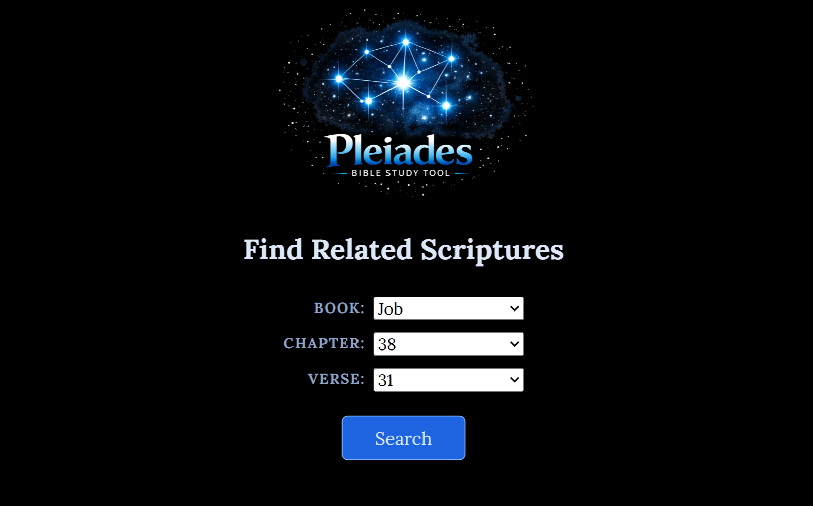
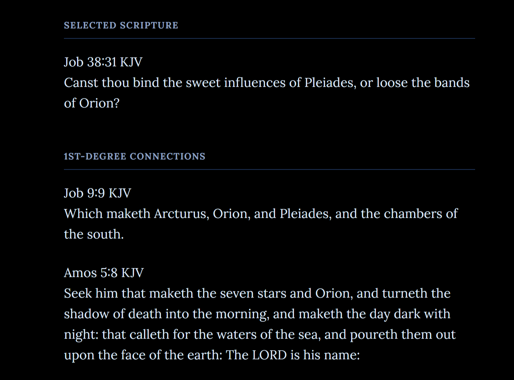
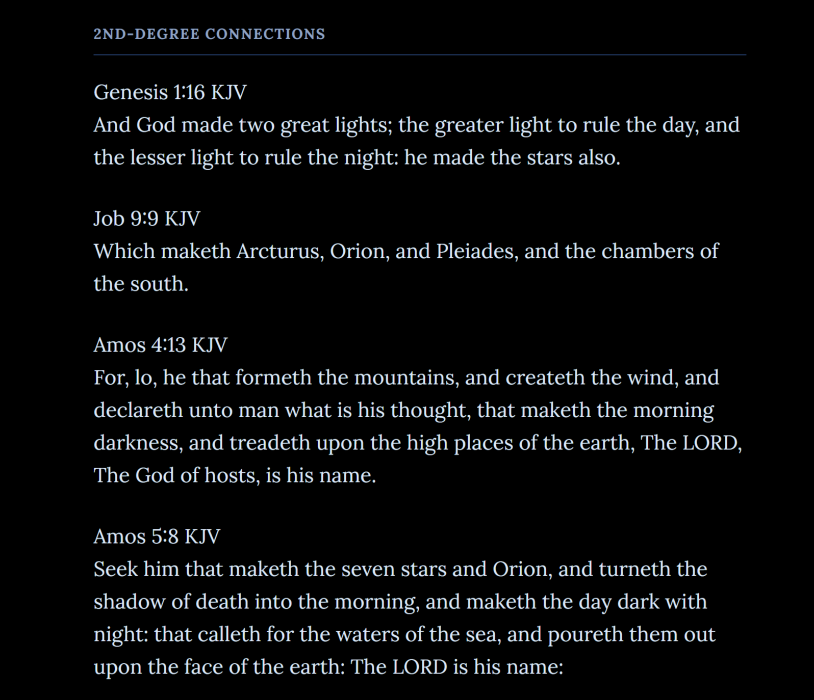

# Pleiades Bible Study Tool

Pleiades is a scripture analysis app for the King James Version (KJV) Bible. Select a book, chapter, and verse; then, explore scripture connections.

**Live app:** [https://pleiades-bible-study-tool.fastapicloud.dev/](https://pleiades-bible-study-tool.fastapicloud.dev/)

> **Note:** The first request after a period of inactivity may be slow during startup. Please allow a few seconds for the page to load.

## Author

Delario Nance Jr. ([GitHub](https://github.com/DelarioNance) · [LinkedIn](http://www.linkedin.com/in/delario-nance-jr/))

## Table of Contents

- [App Walkthrough](#app-walkthrough)
- [Tech Stack](#tech-stack)
- [Repository Layout](#repository-layout)
- [CI/CD](#cicd)
- [Test Reports](#test-reports)
- [Known Limitations](#known-limitations)
- [Data Sources and Citations](#data-sources-and-citations)

## App Walkthrough

| 1. Choose a scripture |
|:---:|
|  |

| 2. View the scripture and its 1st-degree connections |
|:---:|
|  |

| 3. Explore 2nd-degree connections |
|:---:|
|  |

> **Note on degrees:** Connections are counted by number of cross-reference steps from the selected scripture. In Pleiades, a scripture can appear as both a 1st-degree and a 2nd-degree connection. This differs from LinkedIn's definition of 2nd-degree connections, which excludes anyone who is already a 1st-degree connection.

## Tech Stack

| Layer | Tools |
|-------|-------|
| Database | PostgreSQL, Supabase |
| ETL source code | Python, SQL |
| API source code | Python, FastAPI |
| UI source code | HTML, CSS, JavaScript |
| ETL tests | Pytest, Python, SQL |
| API tests | Pytest, Python, FastAPI |
| UI tests | Playwright, Java, Maven |
| CI/CD | GitHub Actions, FastAPI Cloud |

## Repository Layout

| Folder | Contents | Details |
|--------|----------|---------|
| `src/` | Application code | [src/README.md](src/README.md) |
| `tests/` | Automated tests | [tests/README.md](tests/README.md) |
| `.github/workflows/` | CI, staging and production deployment, and staging test pipelines | [.github/workflows/README.md](.github/workflows/README.md) |

## CI/CD

Pull requests run the full test suite against a temporary database. Merging to `main` deploys to staging and runs the UI tests against it. Production is deployed by a manual run. See the [workflows README](.github/workflows/README.md) for details.

## Test Reports

Allure reports are automatically generated and published for Continuous Integration and Staging Test workflow runs.

Report URLs follow these patterns:

- Continuous Integration:
  https://delarionance.github.io/pleiades-bible-study-tool/test-reports/continuous-integration/run-{GITHUB_ACTIONS_WORKFLOW_RUN_NUMBER}

- Staging Tests:
  https://delarionance.github.io/pleiades-bible-study-tool/test-reports/staging-tests/run-{GITHUB_ACTIONS_WORKFLOW_RUN_NUMBER}

Replace `{GITHUB_ACTIONS_WORKFLOW_RUN_NUMBER}` with the workflow run number from the GitHub Actions run you want to see results for.

## Known Limitations

Each layer's README lists its own planned improvements. Notable ones include:

- **Verse text accuracy depends on an external source.** Verse passages come from the Free Use Bible API, and Pleiades does not independently verify them, so any errors in that data may appear in the app as is.
- **New data sources are not supported.** The ETL is built around the current KJV source data, so adding another translation or source would require reworking the ETL.
- **Deployments can briefly block the app.** The ETL rebuilds the database in a transaction, so staging and production may be unavailable or slow to respond while a deployment is running.

## Data Sources and Citations

"Bible Cross References" by [OpenBible.info](https://www.openbible.info/), sourced from https://www.openbible.info/labs/cross-references/, licensed under [CC BY 4.0](https://creativecommons.org/licenses/by/4.0/); extracted, transformed, and loaded into a SQL database.

"Free Use Bible API" by [AO Lab](https://www.helloao.org/free-api.html), sourced from https://bible.helloao.org/docs/, licensed under [CC0 1.0](https://creativecommons.org/publicdomain/zero/1.0/); extracted, transformed, and loaded into a SQL database.